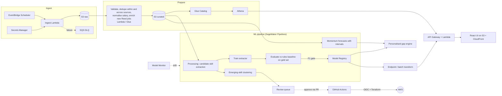

# Architecture

## Status

| Phase | Scope | State |
|---|---|---|
| 1. Foundations | Repo, Terraform state, OIDC, CI, data buckets, ingestion Lambda and schedule | **Scaffolded** |
| 2. Data | Glue catalog, Athena, validation, cross-source dedupe, curated layer, Step Functions | Next |
| 3. ML | Evaluated skill extraction, emerging-skill detection, momentum forecasts, personalised gap engine, SageMaker Pipelines and Model Registry | |
| 4. Serving and UI | Endpoint, API Gateway, React front end on CloudFront, methodology page | |
| 5. Monitoring | Model Monitor, vocabulary drift, retraining triggers, dashboards, budgets and alarms | |

The detailed plan, evaluation approach, MVP cut lines and risks are in [roadmap.md](roadmap.md).

## Design decisions

- **Dependency-free ingestion Lambda.** It uses `urllib` and the `boto3` bundled in the Lambda
  runtime, so packaging is a plain zip and cold starts stay small. Heavier dependencies arrive
  with the SageMaker steps, where containers are the right tool.
- **Per-source failure isolation.** A failing source never discards another source's data;
  the Lambda still raises afterwards so the failure reaches the DLQ alarm.
- **Three sources, one canonical record.** Adzuna, Reed and Hacker News each map into
  `JobPosting`. Sources are built independently, so a missing secret for one source is reported
  as that source's error and the others still run.
- **Reed detail enrichment deferred.** Reed search returns truncated descriptions. Fetching the
  full text per job is left to a phase 2 step that only fetches postings not seen before, which
  keeps API usage low.
- **Hive-partitioned raw layout** (`source=/dt=`) so Athena can prune partitions cheaply.
- **Idempotent downstream.** Re-runs can duplicate rows; every record carries a `dedupe_key`.
- **OIDC, not access keys.** The plan role is read-only and assumable from pull requests; the
  apply role is assumable only from jobs in the `dev` GitHub environment.
- **Scheduler disabled by default** until the API secret exists, so a first deploy cannot fail
  on missing credentials.
